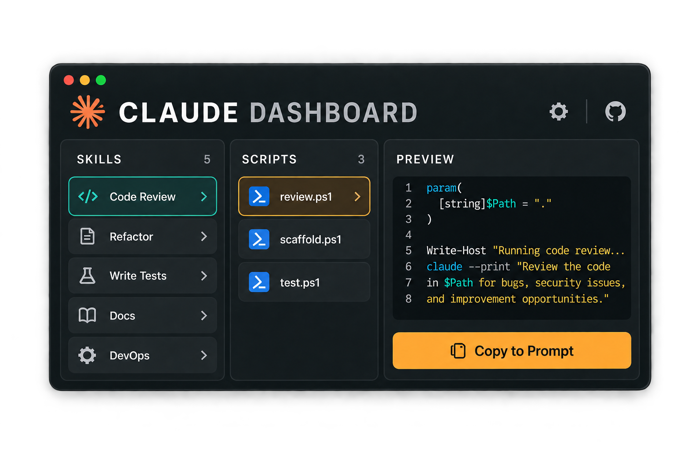

# Claude Dashboard

  

A reusable Claude Code plugin that opens a project dashboard with /dash. The Skills tab lists the current session's slash commands. The Scripts tab inspects a project's scripts folder and builds commands from PowerShell's own parameter metadata.

The repository is named claude-dashboard. The installed plugin is named project-dashboard.

## What it does

- Groups user, plugin, MCP, and built-in slash commands, with search and prompt-fill actions. If the prompt already has text, choose whether to replace it or add the command at the end.
- Lists scripts from a project's scripts folder and reads PowerShell parameters, validation choices, parameter sets, default presence, and comment-based help.
- Builds a live command preview with quoting and required-parameter markers. Click a script example to load that exact command, and clear individual values or all options.
- Copies a command through the operating system clipboard utility or fills it into Claude's prompt.
- Never executes a project script from the dashboard.

## Requirements

- Claude Code 2.1.299 or later with function-hook mods enabled.
- PowerShell 7 is recommended. Windows PowerShell is tried as a fallback.
- Node.js, Python, or Bash is only needed to run matching non-PowerShell scripts after the command has been copied or filled.

## Try it locally

From this repository, load the plugin for one session:

    claude --plugin-dir .

Then enter /dash.

## Install for every project

Clone this repository to a stable folder outside any game or application repository. Add it as a local marketplace and install the plugin for the user:

    claude plugin marketplace add C:\path\to\claude-dashboard
    claude plugin install project-dashboard@claude-dashboard --scope user

Restart Claude Code, then use /dash in any project. To update the installed plugin, pull the repository and run:

    claude plugin update project-dashboard --scope user

The source uses Claude Code's early-access function-hook API. See the [Claude Code mods guide](https://github.com/anthropics/claude-code/blob/main/mods/README.md) and [API types](https://github.com/anthropics/claude-code/blob/main/mods/types/claude-code.d.ts). Validate the plugin after Claude Code updates because the API may change between releases.

## Script discovery and safety

The Scripts tab only lists these file types: ps1, mjs, js, py, and sh. The PowerShell AST parser finds top-level parameter defaults without evaluating their expressions. The describer removes dynamic-parameter blocks from its temporary copy before asking Get-Command and Get-Help for static metadata and comment-based help. It never runs a project script; a script with dynamic parameters shows a warning and lists only static options. Temporary copies are removed after reading.

The command preview uses named parameters so the copied command is readable. Values are quoted for PowerShell. Missing required parameters appear as <required>. Copy and Fill prompt remain available while required values are missing.

The Copy action invokes a fixed operating-system clipboard utility and passes the preview through standard input. It does not build a shell command from the preview. Clipboard helpers are tried in this order: pwsh, Windows PowerShell, pbcopy, wl-copy, xclip, xsel.

## Development checks

    claude plugin validate .
    claude plugin test .
    pwsh -NoProfile -File tests/describe-scripts.test.ps1

Tests render the pane on terminal and desktop surfaces and cover command groups and filtering, prompt replace/append choices, parameter sets, defaults, examples, per-flag clearing, command quoting, clipboard input, and the script drill-down.

The project-specific Claude Code API declarations can be generated from an active session with /plugin-types. The API is early access, so generated declarations should match the installed CLI rather than be copied from another release.
